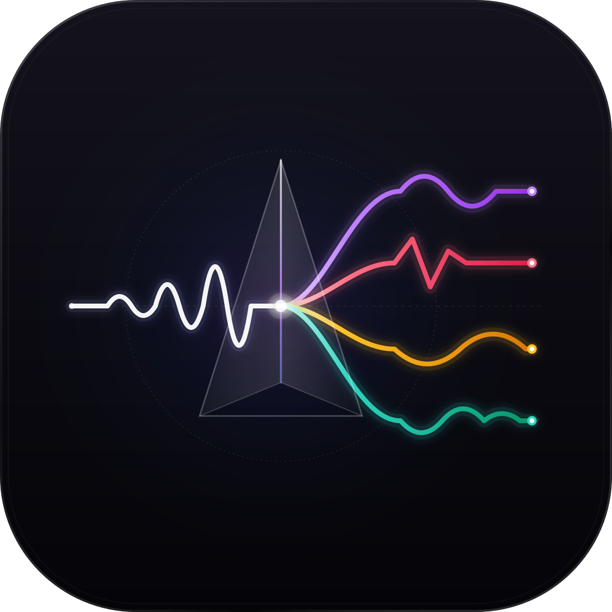

<p align="center">
  
</p>

<h1 align="center">StemTool</h1>

<p align="center">
  <strong>High-performance, 100% local audio stem separation for music producers, audio engineers, DJs, and video creators.</strong>
</p>

<p align="center">
  <a href="https://github.com/slice-of-fun/stemtool/releases/latest"></a>
  
  
  
  <a href="LICENSE"></a>
</p>

---

## ⚡ Direct Downloads (v0.10.0)

Get the latest pre-compiled binaries directly from the [GitHub Releases](https://github.com/slice-of-fun/stemtool/releases/latest):

### 🖥️ Desktop Application

| Operating System | Download Links | Type & Architecture |
| :--- | :--- | :--- |
| **Windows** | 📥 [**Download Installer (.exe)**](https://github.com/slice-of-fun/stemtool/releases/download/v0.10.0/StemTool-0.10.0-win-x64.exe)<br/>📦 [Download Portable (.zip)](https://github.com/slice-of-fun/stemtool/releases/download/v0.10.0/StemTool-0.10.0-win-x64.zip) | Windows 10/11 (64-bit) |
| **macOS (Apple Silicon)** | 📥 [**Download DMG (Apple Silicon)**](https://github.com/slice-of-fun/stemtool/releases/download/v0.10.0/StemTool-0.10.0-mac-arm64.dmg)<br/>📦 [Download Portable (.zip)](https://github.com/slice-of-fun/stemtool/releases/download/v0.10.0/StemTool-0.10.0-mac-arm64.zip) | M1 / M2 / M3 / M4 (arm64) |
| **macOS (Intel)** | 📥 [**Download DMG (Intel)**](https://github.com/slice-of-fun/stemtool/releases/download/v0.10.0/StemTool-0.10.0-mac-x64.dmg)<br/>📦 [Download Portable (.zip)](https://github.com/slice-of-fun/stemtool/releases/download/v0.10.0/StemTool-0.10.0-mac-x64.zip) | Intel Core x86_64 |
| **Linux** | 📥 [**Download AppImage**](https://github.com/slice-of-fun/stemtool/releases/download/v0.10.0/StemTool-0.10.0-linux-x64.AppImage)<br/>📦 [Download Debian Package (.deb)](https://github.com/slice-of-fun/stemtool/releases/download/v0.10.0/StemTool-0.10.0-linux-x64.deb) | Ubuntu 20.04+, Debian, Fedora, Arch (x64) |

### 🎬 Adobe Premiere Pro Extension Plugin

| Component | Download Link | Description |
| :--- | :--- | :--- |
| **Premiere Pro CEP Extension** | 📥 [**StemTool-Premiere-Plugin-v0.10.0.zip**](https://github.com/slice-of-fun/stemtool/releases/download/v0.10.0/StemTool-Premiere-Plugin-v0.10.0.zip) | 1-Click timeline stem splitter extension for Premiere Pro (Win & Mac) |

*👉 All release artifacts, checksums, and previous versions are available on the [Releases Page](https://github.com/slice-of-fun/stemtool/releases).*

---

## 🎯 What StemTool Does

StemTool splits any music track or audio clip into clean, studio-grade isolated stems:

- 🎤 **Vocals** (Acapella lead & backing vocals)
- 🥁 **Drums** (Kick, snare, hi-hats, percussion)
- 🎸 **Bass** (Bass guitar, synth bass, sub-bass frequencies)
- 🎹 **Other / Instrumental** (Guitars, synths, pianos, brass, and backing instruments)

### Dual-Environment Workflow:

1. **Standalone Desktop DAW Workstation**:
   - **Multi-Track Mixing Console**: Dedicated volume faders, stereo panning knobs, mute, and solo buttons for every stem channel.
   - **Interactive Waveform Scrubbing**: Visual audio waveform canvas with real-time seeking and zero-latency preview playback.
   - **Search or Import**: Search YouTube audio directly from inside the app, or drag-and-drop local audio/video files (`.wav`, `.mp3`, `.flac`, `.m4a`, `.aac`, `.ogg`, `.aiff`, `.mp4`, `.mov`, `.mkv`).
   - **Export Formats**: Export individual stems or all channels simultaneously as uncompressed 24-bit/32-bit float WAV or high-bitrate AAC (256 kbps).

2. **Native Adobe Premiere Pro Timeline Integration**:
   - Select any dialogue or music clip directly on your active sequence timeline (Track `A1`).
   - Click **Split Selected Clip** in the StemTool extension panel.
   - StemTool automatically separates the audio and synchronizes the stems across new audio tracks (`A2` = Vocals, `A3` = Drums, `A4` = Bass, `A5` = Other) with zero manual alignment needed.

---

## 🔬 What It Uses (Technology Stack & Under the Hood)

StemTool combines state-of-the-art machine learning models with a native, high-performance audio processing pipeline:

```
┌────────────────────────────────────────────────────────┐
│               Audio Source (File / Timeline)           │
└───────────────────────────┬────────────────────────────┘
                            │
                            ▼
┌────────────────────────────────────────────────────────┐
│      Bundled Native FFmpeg with SoX Resampler          │
│          (High-Fidelity 44.1 kHz / 28-bit)             │
└───────────────────────────┬────────────────────────────┘
                            │
              ┌─────────────┴─────────────┐
              ▼                           ▼
┌───────────────────────────┐ ┌──────────────────────────┐
│     Mel-Band Roformer     │ │    HTDemucs v4 (Meta)    │
│  (Sub-Band Transformer)   │ │  (Hybrid Transformer)   │
│   Pristine Vocal & Lead   │ │   Drums, Bass & Music    │
└─────────────┬─────────────┘ └───────────┬──────────────┘
              │                           │
              └─────────────┬─────────────┘
                            ▼
┌────────────────────────────────────────────────────────┐
│            Isolated Lossless Multi-Stem Audio          │
└───────────────────────────┬────────────────────────────┘
                            │
              ┌─────────────┴─────────────┐
              ▼                           ▼
┌───────────────────────────┐ ┌──────────────────────────┐
│    StemTool Desktop DAW   │ │  Premiere Pro Timeline   │
│ (React 18 / Web Audio API)│ │ (CEP Panel + Track Sync) │
└───────────────────────────┘ └──────────────────────────┘
```

### 1. Neural Separation Models
- **Mel-Band Roformer**: Cutting-edge frequency-domain transformer architecture using sub-band attention for hyper-accurate vocal separation with zero phase distortion and minimal bleed.
- **HTDemucs v4 (Hybrid Transformer Demucs)**: Developed by Meta AI Research, combining time-domain convolutions with cross-domain transformers to isolate drums, bass, and instrumental elements with deep punch and clarity.

### 2. Hardware-Accelerated Local Inference
- **Apple Silicon (macOS)**: Native Apple Metal Performance Shaders (**MPS**) acceleration for M1, M2, M3, and M4 chips.
- **NVIDIA GPUs (Windows & Linux)**: High-throughput **CUDA** acceleration with automated VRAM optimization.
- **Multi-Threaded CPU Fallback**: SIMD-accelerated CPU inference when no dedicated GPU is present.

### 3. Audiophile Resampling Pipeline
- **Bundled FFmpeg with native SoX Resampler (`libsoxr`)**: Custom-built static FFmpeg binary compiled with `libsoxr`. Performs all internal sample-rate conversions at 44.1 kHz with 28-bit precision, completely eliminating the aliasing and high-frequency roll-off common in standard resamplers.

### 4. Modern Desktop & Extension Architecture
- **Desktop Application**: Built with **Electron 33**, **Node.js 24**, **React 18**, **TypeScript**, and **Tailwind CSS** with context-isolated IPC.
- **Premiere Pro Extension**: Standard Adobe **CEP 12** HTML5 panel bridging to an ExtendScript JSX engine for timeline track placement.
- **Local Engine Daemon**: The desktop application runs a decoupled local IPC interface that handles all PyTorch weight loading and inference without locking up video editing software.

---

## 🔒 100% Local & Offline

- **On-Device Audio Processing**: Your songs, voiceovers, stems, and project files never leave your computer.
- **Zero Cloud Dependencies**: All separation models run directly on your hardware using local runtimes.
- **Full Offline Capability**: Works seamlessly on flights, in remote studios, or completely disconnected from the internet.

---

## 🚀 Installation & Quick Start

### Windows (Desktop)
1. Download [**StemTool-0.10.0-win-x64.exe**](https://github.com/slice-of-fun/stemtool/releases/download/v0.10.0/StemTool-0.10.0-win-x64.exe).
2. Run the installer (or extract the `.zip` portable version).
3. Open **StemTool**, drop in an audio file, choose your model, and click **Separate**.
   *(On first run, the app automatically downloads model weights (~2 GB) to your local cache).*

### macOS (Desktop)
1. Download [**StemTool-0.10.0-mac-arm64.dmg**](https://github.com/slice-of-fun/stemtool/releases/download/v0.10.0/StemTool-0.10.0-mac-arm64.dmg) (Apple Silicon) or [**StemTool-0.10.0-mac-x64.dmg**](https://github.com/slice-of-fun/stemtool/releases/download/v0.10.0/StemTool-0.10.0-mac-x64.dmg) (Intel).
2. Open the `.dmg` and drag **StemTool** into your `Applications` folder.
3. Launch **StemTool** from Applications.

### Linux (Desktop)
1. Download [**StemTool-0.10.0-linux-x64.AppImage**](https://github.com/slice-of-fun/stemtool/releases/download/v0.10.0/StemTool-0.10.0-linux-x64.AppImage).
2. Make it executable and run:
   ```bash
   chmod +x StemTool-0.10.0-linux-x64.AppImage
   ./StemTool-0.10.0-linux-x64.AppImage
   ```
   *(Or install the `.deb` package via `sudo dpkg -i StemTool-0.10.0-linux-x64.deb`)*.

---

### 🎬 Installing the Adobe Premiere Pro Plugin

The Premiere Pro plugin integrates directly into Adobe Premiere Pro 2020 through 2025.

1. Download [**StemTool-Premiere-Plugin-v0.10.0.zip**](https://github.com/slice-of-fun/stemtool/releases/download/v0.10.0/StemTool-Premiere-Plugin-v0.10.0.zip) and extract it.
2. Run the automated installer script:
   - **Windows**: Right-click `install-plugin.ps1` → **Run with PowerShell** (or run in PowerShell as Administrator).
   - **macOS**: Open Terminal in the extracted directory and run:
     ```bash
     chmod +x install-plugin.sh
     ./install-plugin.sh
     ```
3. Restart Premiere Pro.
4. Open the extension from **Window → Extensions → StemTool**.
5. Select an audio clip on your timeline and click **Split Selected Clip**.

---

## 🛠️ Development & Building from Source

### Prerequisites
- [Node.js](https://nodejs.org) 24+
- `npm` or `pnpm`
- Python 3.10+ (with PyTorch and CUDA/MPS if testing local ML models)

### Clone & Install
```bash
git clone https://github.com/slice-of-fun/stemtool.git
cd stemtool

# Install Node dependencies
npm install
```

### Running Locally in Dev Mode
```bash
npm run dev
```

### Packaging Installers
```bash
# 1. Fetch bundled FFmpeg binaries with libsoxr
powershell scripts/fetch-ffmpeg.ps1  # Windows
bash scripts/fetch-ffmpeg.sh        # macOS / Linux

# 2. Build executables & installers
npm run dist:win    # Windows installer (.exe) & portable (.zip)
npm run dist        # macOS DMG
npm run dist:linux  # Linux AppImage & deb
```

### Running Automated Tests
```bash
npm test
```

---

## 📂 Repository Layout

```
├── build/                 # App icon artwork (SVG/PNG) and build configuration
├── docs/                  # Documentation assets & vector logos
├── premiere-plugin/       # Adobe Premiere Pro CEP extension plugin
│   ├── CSXS/              # Manifest configuration
│   ├── js/                # Panel frontend & local StemTool bridge
│   ├── jsx/               # ExtendScript timeline track generator
│   ├── install-plugin.ps1 # 1-click Windows installer script
│   └── install-plugin.sh  # 1-click macOS installer script
├── python/                # Neural model inference scripts (Roformer & Demucs)
├── scripts/               # Build utilities, FFmpeg compilation, and packaging scripts
├── src/
│   ├── main/              # Electron main process, IPC, and separation job pipeline
│   ├── preload/           # Context-isolated secure preload bridge
│   ├── renderer/          # React audio player, multi-track waveforms & mixer UI
│   └── shared/            # Shared types and IPC contracts
└── tests/                 # Audio engine, pan persistence, and path tests
```

---

## 📄 License

StemTool is released under the [MIT License](LICENSE). Built for music creators, audio engineers, and video editors by [slice-of-fun](https://github.com/slice-of-fun).
